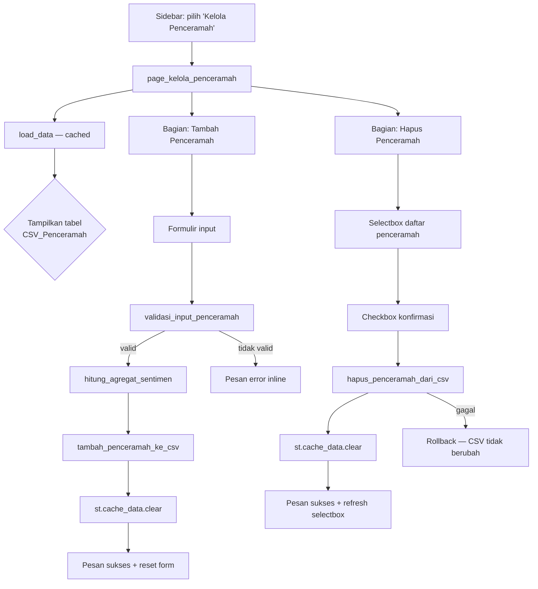

# Design Document: Kelola Penceramah

## Overview

Fitur **Kelola Penceramah** menambahkan satu halaman baru pada dashboard Streamlit (`app.py`) yang memungkinkan peneliti menambah dan menghapus entri penceramah langsung dari UI — tanpa perlu memanipulasi CSV secara manual.

Halaman baru ini (`page_kelola_penceramah`) diintegrasikan ke sidebar navigasi yang sudah ada (`st.sidebar.radio`). Semua operasi tulis (tambah/hapus) dieksekusi langsung pada `data/dataset_final_per_penceramah.csv` di disk, diikuti oleh `st.cache_data.clear()` agar seluruh halaman dashboard memuat data terbaru pada render berikutnya.

Fitur ini bersifat **lokal dan administratif**: tidak berinteraksi dengan model Naive Bayes, tidak mengubah `CSV_Komentar` atau `CSV_Video`, dan tidak memiliki backend terpisah — semua logika ada di `app.py`.

---

## Architecture

Arsitektur fitur mengikuti pola yang sudah ada di `app.py`: satu fungsi halaman (`page_kelola_penceramah`) yang dipanggil dari fungsi `main()` berdasarkan pilihan sidebar. Tidak ada modul tambahan; seluruh logika bisnis (validasi, kalkulasi, I/O) diimplementasikan sebagai fungsi helper murni yang bisa diuji secara terpisah.



**Aliran data tulis (add/delete):**

1. User mengisi form / memilih penceramah
2. Fungsi validasi murni dijalankan — jika gagal, hentikan dan tampilkan error
3. DataFrame dimuat ulang dari disk (bukan dari cache) untuk memastikan konsistensi
4. Operasi tulis dieksekusi ke disk dengan `atomic write` (write ke file sementara, lalu rename)
5. `st.cache_data.clear()` dipanggil
6. UI menampilkan pesan sukses dan memperbarui tampilan

---

## Components and Interfaces

### 1. `page_kelola_penceramah()` — fungsi halaman utama

Dipanggil dari `main()`. Bertanggung jawab atas rendering seluruh halaman, termasuk tabel data, formulir tambah, dan bagian hapus.

```python
def page_kelola_penceramah() -> None: ...
```

### 2. `validasi_input_penceramah(channel_name, jumlah_positif, jumlah_negatif, jumlah_netral, df_existing)` — validasi form tambah

Fungsi murni (pure function) yang menerima input form dan DataFrame penceramah yang sudah ada. Mengembalikan `(is_valid: bool, error_message: str)`.

```python
def validasi_input_penceramah(
    channel_name: str,
    jumlah_positif: int,
    jumlah_negatif: int,
    jumlah_netral: int,
    df_existing: pd.DataFrame,
) -> tuple[bool, str]: ...
```

Aturan validasi (dieksekusi berurutan, berhenti pada kesalahan pertama):
1. `channel_name` setelah strip tidak boleh kosong → error "Nama penceramah tidak boleh kosong."
2. Ketiga nilai jumlah harus bilangan bulat ≥ 0 (sudah dijamin oleh `st.number_input`, tapi fungsi tetap memvalidasi)
3. `channel_name` (case-insensitive, stripped) tidak boleh sudah ada di `df_existing['channel_name']` → error "Penceramah dengan nama tersebut sudah ada."

### 3. `hitung_agregat_sentimen(jumlah_positif, jumlah_negatif, jumlah_netral)` — kalkulasi kolom turunan

Fungsi murni. Menghitung `total_komentar`, `pct_positif`, `pct_negatif`, `pct_netral`, dan `sentimen_dominan`.

```python
def hitung_agregat_sentimen(
    jumlah_positif: int,
    jumlah_negatif: int,
    jumlah_netral: int,
) -> dict: ...
```

Output dict memiliki kunci:
`total_komentar`, `pct_positif`, `pct_negatif`, `pct_netral`, `sentimen_dominan`

### 4. `tambah_penceramah_ke_csv(path_csv, baris_baru)` — operasi tulis tambah

Memuat CSV dari disk (bukan cache), menambahkan baris baru, lalu menyimpan menggunakan atomic write. Melempar `IOError` jika gagal.

```python
def tambah_penceramah_ke_csv(path_csv: str, baris_baru: dict) -> None: ...
```

### 5. `hapus_penceramah_dari_csv(path_csv, channel_name)` — operasi tulis hapus

Memuat CSV dari disk, menghapus baris yang cocok (case-sensitive match karena `channel_name` berasal dari selectbox yang populated dari CSV itu sendiri), lalu menyimpan menggunakan atomic write. Melempar `IOError` jika gagal.

```python
def hapus_penceramah_dari_csv(path_csv: str, channel_name: str) -> None: ...
```

### 6. Integrasi ke `main()`

```python
# Tambah pada daftar options sidebar:
"Kelola Penceramah"

# Tambah kondisi routing:
elif pilihan == "Kelola Penceramah":
    page_kelola_penceramah()
```

---

## Data Models

### Skema CSV_Penceramah

Berdasarkan `data/dataset_final_per_penceramah.csv` yang sudah ada:

| Kolom            | Tipe       | Keterangan                                              |
|------------------|------------|---------------------------------------------------------|
| `channel_name`   | `str`      | Nama unik penceramah / channel YouTube; identifier utama |
| `total_komentar` | `int`      | Jumlah total komentar = positif + negatif + netral      |
| `jumlah_positif` | `int`      | Jumlah komentar berlabel Positif                        |
| `jumlah_negatif` | `int`      | Jumlah komentar berlabel Negatif                        |
| `jumlah_netral`  | `int`      | Jumlah komentar berlabel Netral                         |
| `pct_positif`    | `float`    | Persentase positif, 1 desimal                           |
| `pct_negatif`    | `float`    | Persentase negatif, 1 desimal                           |
| `pct_netral`     | `float`    | Persentase netral, 1 desimal                            |
| `sentimen_dominan` | `str`   | Salah satu dari: "Positif", "Negatif", "Netral"         |

CSV ini memiliki kolom index tak bernama (kolom pertama) yang dihasilkan oleh `pd.DataFrame.to_csv()` default. Operasi tulis harus mempertahankan format ini (menggunakan `df.to_csv(path, index=True)`) untuk konsistensi dengan data asli.

### Struktur baris baru (dict yang dihasilkan `hitung_agregat_sentimen`)

```python
{
    "channel_name":   str,   # dari input form, setelah strip
    "total_komentar": int,
    "jumlah_positif": int,
    "jumlah_negatif": int,
    "jumlah_netral":  int,
    "pct_positif":    float, # dibulatkan 1 desimal
    "pct_negatif":    float,
    "pct_netral":     float,
    "sentimen_dominan": str, # "Positif" | "Negatif" | "Netral"
}
```

### Aturan kalkulasi

```
total_komentar = jumlah_positif + jumlah_negatif + jumlah_netral

pct_positif = round(jumlah_positif / total_komentar * 100, 1)  # jika total > 0
pct_positif = 0.0  # jika total == 0

sentimen_dominan:
  - ambil label dengan nilai jumlah tertinggi
  - jika ada seri (dua atau lebih label dengan nilai sama dan tertinggi) → "Positif"
```

### Atomic Write Pattern

Untuk mencegah korupsi file CSV jika terjadi crash di tengah proses tulis:

```
1. Tulis ke file sementara: <path_csv>.tmp
2. Jika berhasil: os.replace(<path_csv>.tmp, path_csv)
3. Jika gagal: hapus file sementara, lempar IOError
```

`os.replace()` bersifat atomic pada sistem operasi modern (POSIX dan Windows).

---

## Error Handling

| Skenario | Perilaku |
|---|---|
| File CSV_Penceramah tidak ditemukan saat halaman dimuat | `st.error()` dengan path absolut; tidak render konten halaman |
| `channel_name` kosong setelah strip | `st.error("Nama penceramah tidak boleh kosong.")` |
| `channel_name` sudah ada (case-insensitive) | `st.error("Penceramah dengan nama tersebut sudah ada.")` |
| Tombol konfirmasi hapus ditekan tanpa centang checkbox | `st.warning()` — tidak eksekusi hapus |
| `IOError` saat menulis CSV (tambah) | `st.error()` dengan pesan kegagalan; cache tidak di-clear; data in-memory tidak berubah |
| `IOError` saat menulis CSV (hapus) | `st.error()` dengan pesan kegagalan; file CSV tetap identik karena atomic write belum selesai |
| CSV_Penceramah kosong (tidak ada baris data) | Tabel menampilkan header + pesan info; selectbox dinonaktifkan; tombol hapus dinonaktifkan |

Semua `st.error()` dan `st.warning()` ditampilkan secara inline di halaman — tidak ada `st.stop()` pada error form agar pengguna bisa memperbaiki input tanpa reload.

---

## Testing Strategy

Fitur ini adalah operasi CRUD sederhana terhadap file CSV tanpa transformasi data yang kompleks. Property-based testing (PBT) **tidak tepat** untuk fitur ini karena:
- Operasi I/O (baca/tulis CSV ke disk) adalah side-effect, bukan pure function
- UI Streamlit tidak dapat diuji dengan PBT
- Perilaku tidak bervariasi secara bermakna dengan banyak input acak — contoh spesifik sudah mencukupi

Strategi yang digunakan adalah **unit tests berbasis contoh** untuk logika murni dan **integration tests** untuk aliran end-to-end.

### Unit Tests (pytest)

Target: fungsi-fungsi pure/helper yang tidak bergantung pada Streamlit atau disk.

**`test_validasi_input_penceramah`**

```python
# Contoh kasus yang harus dicakup:
# - channel_name kosong ("", "   ") → error "Nama penceramah tidak boleh kosong."
# - channel_name valid, belum ada di df → (True, "")
# - channel_name sudah ada (exact match) → error duplikat
# - channel_name sudah ada (case berbeda, "ustadz A" vs "Ustadz A") → error duplikat
# - channel_name sudah ada (whitespace extra) → error duplikat
```

**`test_hitung_agregat_sentimen`**

```python
# Kasus yang harus dicakup:
# - (10, 5, 5) → total=20, pct_positif=50.0, sentimen_dominan="Positif"
# - (0, 0, 0)  → total=0, semua pct=0.0, sentimen_dominan="Positif" (seri)
# - (3, 5, 2)  → sentimen_dominan="Negatif"
# - (5, 5, 3)  → seri Positif & Negatif → sentimen_dominan="Positif"
# - (0, 0, 7)  → sentimen_dominan="Netral"
# - pembulatan: (1, 0, 2) → total=3, pct_positif=33.3, pct_netral=66.7
```

### Integration Tests (pytest + file sementara)

Target: `tambah_penceramah_ke_csv` dan `hapus_penceramah_dari_csv` dengan file CSV nyata di direktori temporer (`tmp_path` fixture pytest).

```python
# Skenario tambah:
# - tambah penceramah baru ke CSV kosong → baris muncul di CSV
# - tambah penceramah baru ke CSV berisi data → baris ditambahkan, baris lama tetap ada
# - simulasi IOError (file read-only) → IOError dilempar, file tidak berubah

# Skenario hapus:
# - hapus penceramah yang ada → baris hilang dari CSV, baris lain tetap
# - hapus penceramah dari CSV satu baris → CSV menjadi kosong (hanya header)
# - simulasi IOError → IOError dilempar, file asli tidak berubah (atomic write)
```

### Manual / Smoke Tests

Karena komponen UI Streamlit tidak bisa diuji dengan pytest standar, pengujian berikut dilakukan secara manual:

- Halaman "Kelola Penceramah" muncul di sidebar dan dapat diakses
- Form tambah: semua pesan validasi muncul dengan benar
- Form tambah: setelah sukses, tabel diperbarui dan form ter-reset
- Form hapus: checkbox wajib sebelum konfirmasi berfungsi
- Form hapus: setelah sukses, penceramah hilang dari selectbox dan tabel
- Navigasi ke halaman lain setelah operasi: data terbaru muncul (cache clear berfungsi)


---

## Correctness Properties

*A property is a characteristic or behavior that should hold true across all valid executions of a system — essentially, a formal statement about what the system should do. Properties serve as the bridge between human-readable specifications and machine-verifiable correctness guarantees.*

Bagian ini hanya mencakup fungsi **pure** yang dapat diverifikasi dengan property-based testing. Fungsi I/O (`tambah_penceramah_ke_csv`, `hapus_penceramah_dari_csv`) dan komponen UI Streamlit diuji dengan integration test dan manual smoke test seperti yang dijelaskan di Testing Strategy.

Library yang direkomendasikan: **[Hypothesis](https://hypothesis.readthedocs.io/)** (Python). Setiap property test dikonfigurasi dengan minimum 100 iterasi (`@settings(max_examples=100)`).

---

### Property 1: Total komentar adalah jumlah dari ketiga komponen

*For any* kombinasi nilai non-negatif `jumlah_positif`, `jumlah_negatif`, dan `jumlah_netral`, nilai `total_komentar` yang dikembalikan oleh `hitung_agregat_sentimen` harus selalu sama dengan `jumlah_positif + jumlah_negatif + jumlah_netral`.

**Validates: Requirements 2.7**

---

### Property 2: Persentase selalu berjumlah tepat 100 (atau semua nol jika total nol)

*For any* kombinasi nilai non-negatif `jumlah_positif`, `jumlah_negatif`, dan `jumlah_netral` di mana total > 0, nilai `pct_positif + pct_negatif + pct_netral` yang dikembalikan harus sama dengan 100.0 (dengan toleransi pembulatan ±0.1). *For any* kombinasi di mana total == 0, ketiga nilai persentase harus masing-masing 0.0.

**Validates: Requirements 2.8**

---

### Property 3: Sentimen dominan selalu merupakan label dengan jumlah tertinggi

*For any* kombinasi nilai non-negatif `jumlah_positif`, `jumlah_negatif`, dan `jumlah_netral`, nilai `sentimen_dominan` yang dikembalikan harus merupakan label yang memiliki jumlah terbesar. Jika ada dua atau lebih label dengan jumlah yang sama dan tertinggi, `sentimen_dominan` harus bernilai "Positif".

**Validates: Requirements 2.9**

---

### Property 4: Input whitespace-only selalu ditolak

*For any* string yang terdiri seluruhnya dari karakter whitespace (termasuk string kosong `""`), `validasi_input_penceramah` harus mengembalikan `(False, "Nama penceramah tidak boleh kosong.")` — terlepas dari isi DataFrame yang diberikan.

**Validates: Requirements 2.2, 2.4**

---

### Property 5: Deteksi duplikat bersifat case-insensitive dan strip-insensitive

*For any* `channel_name` yang sudah ada di DataFrame (dengan variasi huruf kapital dan spasi awal/akhir yang berbeda), `validasi_input_penceramah` harus mengembalikan `(False, "Penceramah dengan nama tersebut sudah ada.")`. Sebaliknya, *for any* `channel_name` yang belum ada di DataFrame (setelah normalisasi case dan strip), fungsi harus mengembalikan `(True, "")`.

**Validates: Requirements 2.6**
