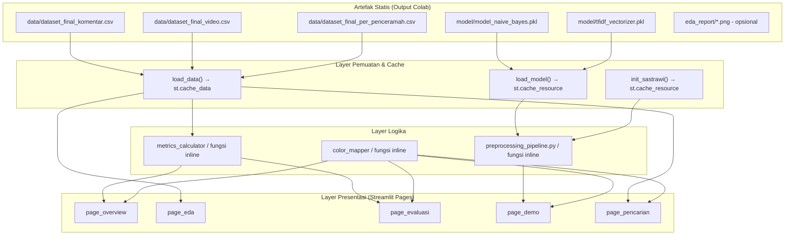

# Dokumen Desain: Sistem Analisis Sentimen Konten Dakwah Digital — Kota Bandung

## Overview

Aplikasi ini adalah antarmuka web berbasis **Streamlit** yang mengekspos seluruh hasil pipeline analisis sentimen komentar YouTube konten dakwah Islam penceramah Bandung, dibangun untuk keperluan skripsi. Aplikasi membaca artefak statis (file CSV dan model `.pkl`) yang dihasilkan oleh tiga notebook Google Colab, lalu menyajikannya dalam lima halaman interaktif: **Overview**, **EDA Dashboard**, **Evaluasi Model**, **Demo Klasifikasi Real-Time**, dan **Pencarian Penceramah & Sentimen Video**.

Model klasifikasi yang digunakan adalah **Multinomial Naive Bayes** yang dilatih dengan fitur TF-IDF. Preprocessing teks menggunakan library **Sastrawi** (PySastrawi) untuk stemming dan penghapusan stopword Bahasa Indonesia, identik dengan pipeline di Colab agar tidak ada distributional shift antara training dan inference.

### Tujuan Desain

- Menyajikan hasil riset dalam format yang dapat dinavigasi dan direproduksi.
- Memastikan konsistensi pipeline preprocessing antara Colab dan Streamlit.
- Menjaga arsitektur sesederhana mungkin (cocok untuk konteks skripsi, satu orang developer).
- Portabel: berjalan dengan satu perintah `streamlit run app.py` di mesin baru.

---

## Architecture

### Arsitektur High-Level

Aplikasi menggunakan arsitektur **monolitik single-file** (`app.py`) dengan pemisahan logis melalui fungsi. Ini dipilih karena:
- Skala kecil (5 halaman, 1 developer).
- Streamlit v1.x mendukung `st.Page` / `st.navigation` untuk routing tanpa memerlukan direktori `pages/`.
- Mempermudah distribusi dan pemeliharaan untuk konteks skripsi.



### Struktur File / Modul

Keputusan desain: **monolitik `app.py`** (bukan direktori `pages/`).

Alasan: Sastrawi dan model pkl perlu di-cache di session level; berbagi state `st.cache_resource` antar file di direktori `pages/` memerlukan modul terpisah yang menambah kompleksitas. Dengan satu file, semua fungsi cache berada dalam scope yang sama.

```
project_root/
├── app.py                              ← Entry point tunggal
├── requirements.txt
├── model/
│   ├── model_naive_bayes.pkl
│   └── tfidf_vectorizer.pkl
├── data/
│   ├── dataset_final_komentar.csv
│   ├── dataset_final_video.csv
│   └── dataset_final_per_penceramah.csv
└── eda_report/                         ← Opsional, 9 PNG
    ├── plot_01_distribusi_sentimen.png
    ├── plot_02_top_penceramah.png
    ├── plot_03_distribusi_topik_pie.png
    ├── plot_04_distribusi_topik_bar.png
    ├── plot_05_heatmap_penceramah_topik.png
    ├── plot_06_top_kata.png
    ├── plot_07_wordcloud.png
    ├── plot_08_confusion_matrix.png
    └── plot_09_classification_report.png
```

### Organisasi Kode di `app.py`

```
app.py
├── [HEADER] Konstanta identitas peneliti (NAMA_PENELITI, NIM)
├── [SECTION 1] Konfigurasi halaman & konstanta warna
├── [SECTION 2] Fungsi cache — load_data(), load_model(), init_sastrawi()
├── [SECTION 3] Preprocessing pipeline — cleaning_pipeline(), full_preprocessing()
├── [SECTION 4] Helper UI — get_sentiment_color(), get_sentiment_badge_html()
├── [SECTION 5] Halaman — page_overview(), page_eda(), page_evaluasi(), page_demo(), page_pencarian()
└── [MAIN] Routing sidebar → dispatch ke fungsi halaman
```

---

## Components and Interfaces

### 1. Konstanta Global

```python
# --- EDIT SESUAI DATA PENELITI ---
NAMA_PENELITI = "Nama Lengkap"
NIM           = "XXXXXXXXXX"

# Palet warna sentimen
WARNA_SENTIMEN = {
    "Positif": "#2ecc71",  # hijau
    "Negatif": "#e74c3c",  # merah
    "Netral":  "#95a5a6",  # abu-abu
}

# Path data (relatif terhadap direktori root proyek)
PATH_CSV_KOMENTAR     = "data/dataset_final_komentar.csv"
PATH_CSV_VIDEO        = "data/dataset_final_video.csv"
PATH_CSV_PENCERAMAH   = "data/dataset_final_per_penceramah.csv"
PATH_MODEL_NB         = "model/model_naive_bayes.pkl"
PATH_VECTORIZER       = "model/tfidf_vectorizer.pkl"
DIR_EDA_REPORT        = "eda_report"

# Nama kolom kanonik
KOLOM_LABEL      = "sentiment_label"
KOLOM_PREDIKSI   = "label_prediksi"
KOLOM_SPLIT      = "split"
KOLOM_CHANNEL    = "channel_name"
KOLOM_TOPIK      = "topik_utama"
KOLOM_VIDEO_ID   = "video_id"
KOLOM_KOMENTAR_BERSIH = "komentar_bersih"
```

### 2. Fungsi Cache

#### `load_data() → tuple[pd.DataFrame, pd.DataFrame, pd.DataFrame]`

```python
@st.cache_data
def load_data() -> tuple[pd.DataFrame, pd.DataFrame, pd.DataFrame]:
    """
    Memuat tiga CSV dari disk. Mengembalikan (df_komentar, df_video, df_penceramah).
    Melempar FileNotFoundError dengan pesan yang menyertakan path absolut
    jika salah satu file tidak ditemukan.
    """
```

- Membaca tiga file CSV dengan `pandas.read_csv`.
- Jika file tidak ada: `raise FileNotFoundError(f"File tidak ditemukan: {os.path.abspath(path)}")`.
- Pemanggil bertanggung jawab menangkap exception dan menampilkan `st.error()`.

#### `load_model() → tuple[Any, Any]`

```python
@st.cache_resource
def load_model() -> tuple:
    """
    Memuat model_naive_bayes.pkl dan tfidf_vectorizer.pkl.
    Mengembalikan (model_nb, vectorizer).
    """
```

#### `init_sastrawi() → tuple[Any, Any]`

```python
@st.cache_resource
def init_sastrawi() -> tuple:
    """
    Menginisialisasi Sastrawi Stemmer dan StopWordRemover.
    Mengembalikan (stemmer, stopword_remover).
    """
```

### 3. Preprocessing Pipeline

Pipeline harus **identik secara logika** dengan Script 2 dan Script 3 Colab.

```python
import re
from Sastrawi.Stemmer.StemmerFactory import StemmerFactory
from Sastrawi.StopWordRemover.StopWordRemoverFactory import StopWordRemoverFactory

def hapus_url(t: str) -> str:
    return re.sub(r'http\S+|www\.\S+', ' ', t)

def hapus_mention(t: str) -> str:
    return re.sub(r'[@#]\w+', ' ', t)

def hapus_emoji(t: str) -> str:
    # Menghapus karakter Unicode di luar BMP (emoji, simbol)
    emoji_pattern = re.compile(
        "["
        u"\U0001F600-\U0001F64F"
        u"\U0001F300-\U0001F5FF"
        u"\U0001F680-\U0001F6FF"
        u"\U0001F1E0-\U0001F1FF"
        u"\U00002702-\U000027B0"
        u"\U000024C2-\U0001F251"
        "]+", flags=re.UNICODE
    )
    return emoji_pattern.sub(' ', t)

def hapus_nonalpha(t: str) -> str:
    return re.sub(r'[^a-zA-Z\s]', ' ', t)

def case_folding(t: str) -> str:
    return t.lower()

def norm_spasi(t: str) -> str:
    return re.sub(r'\s+', ' ', t).strip()

def cleaning_pipeline(teks: str) -> str:
    """Stage 1: URL → mention → emoji → non-alfa → case fold → norm spasi."""
    t = hapus_url(teks)
    t = hapus_mention(t)
    t = hapus_emoji(t)
    t = hapus_nonalpha(t)
    t = case_folding(t)
    t = norm_spasi(t)
    return t

def full_preprocessing(teks: str, stopword_remover, stemmer) -> str:
    """Stage 1-3: cleaning → stopword removal → stemming."""
    t = cleaning_pipeline(teks)
    t = stopword_remover.remove(t)
    t = stemmer.stem(t)
    return t
```

**Invariant penting:** Output `cleaning_pipeline` hanya boleh mengandung karakter `[a-z ]` (huruf kecil ASCII dan spasi). Output tidak boleh diawali atau diakhiri spasi.

### 4. Helper UI

```python
def get_sentiment_color(sentimen: str) -> str:
    """Mengembalikan kode hex warna dari WARNA_SENTIMEN. Default abu-abu."""
    return WARNA_SENTIMEN.get(sentimen, "#95a5a6")

def get_sentiment_badge_html(sentimen: str, probabilitas: float | None = None) -> str:
    """
    Mengembalikan HTML badge berwarna untuk label sentimen.
    Opsional: tampilkan probabilitas dalam badge.
    """
    warna = get_sentiment_color(sentimen)
    teks_prob = f" ({probabilitas:.1%})" if probabilitas is not None else ""
    return (
        f'<span style="background-color:{warna};color:white;'
        f'padding:4px 12px;border-radius:12px;font-weight:bold;">'
        f'{sentimen}{teks_prob}</span>'
    )
```

### 5. Komponen Per Halaman

#### Halaman Overview (`page_overview`)

Input: `df_komentar`, `df_penceramah`

Komponen:
- `st.title()` — judul penelitian
- `st.markdown()` — deskripsi penelitian, info peneliti (NAMA_PENELITI, NIM)
- Pipeline diagram — 3 `st.columns()` dengan ikon teks dan panah `→`
- `st.columns(4)` — 4 kartu `st.metric()`: Total Komentar, Jumlah Penceramah, Topik Dakwah, Akurasi Model

Kalkulasi metrik:
```python
total_komentar    = len(df_komentar)
jumlah_penceramah = df_komentar[KOLOM_CHANNEL].nunique()
jumlah_topik      = df_komentar[KOLOM_TOPIK].nunique()
df_test           = df_komentar[df_komentar[KOLOM_SPLIT] == 'test']
akurasi           = (df_test[KOLOM_LABEL] == df_test[KOLOM_PREDIKSI]).mean()
```

#### Halaman EDA Dashboard (`page_eda`)

Input: `df_komentar`, `df_video`

Filter sidebar (diaplikasikan ke `df_komentar` sebelum render):
```python
filter_channel = st.sidebar.multiselect("Filter Penceramah", options=sorted(df_komentar[KOLOM_CHANNEL].unique()))
filter_topik   = st.sidebar.multiselect("Filter Topik", options=sorted(df_komentar[KOLOM_TOPIK].unique()))
```

Enam visualisasi Plotly:
| # | Visualisasi | Fungsi Plotly |
|---|-------------|---------------|
| 1 | Distribusi sentimen (bar) | `px.bar` |
| 2 | Top 15-20 penceramah by jumlah komentar | `px.bar` horizontal |
| 3 | Distribusi topik dakwah (pie) | `px.pie` |
| 4 | Distribusi topik dakwah (bar) | `px.bar` |
| 5 | Heatmap penceramah × topik | `px.density_heatmap` atau `go.Heatmap` |
| 6 | Top 30 kata paling sering (komentar_bersih) | `px.bar` horizontal |

Word cloud:
```python
from wordcloud import WordCloud
import matplotlib.pyplot as plt

teks_gabung = " ".join(df_filtered[KOLOM_KOMENTAR_BERSIH].dropna())
wc = WordCloud(width=800, height=400, background_color='white').generate(teks_gabung)
fig, ax = plt.subplots()
ax.imshow(wc, interpolation='bilinear')
ax.axis('off')
st.image(fig)  # via plt -> buffer -> st.image
```

Expander opsional EDA_Report:
```python
png_files = [p for p in Path(DIR_EDA_REPORT).glob("*.png") if p.exists()]
if png_files:
    with st.expander("Lihat chart asli dari notebook"):
        for png in sorted(png_files):
            st.image(str(png))
```

#### Halaman Evaluasi Model (`page_evaluasi`)

Input: `df_komentar`

Guard clause:
```python
df_test = df_komentar[df_komentar[KOLOM_SPLIT] == 'test']
if df_test.empty:
    st.info("Data split test tidak tersedia di CSV_Komentar.")
    return
```

Komponen:
- Confusion matrix Plotly heatmap (`go.Figure(go.Heatmap(...))`) dengan label Positif/Negatif/Netral
- 4 kartu `st.metric()`: Accuracy, Precision, Recall, F1-Score (weighted avg) via `sklearn.metrics`
- Tabel classification report per kelas — `pd.DataFrame(classification_report(..., output_dict=True)).T`
- Tabel misklasifikasi — `df_salah = df_test[df_test[KOLOM_LABEL] != df_test[KOLOM_PREDIKSI]]` dengan Pandas Styler merah

```python
from sklearn.metrics import confusion_matrix, accuracy_score, precision_score, recall_score, f1_score, classification_report

y_true = df_test[KOLOM_LABEL]
y_pred = df_test[KOLOM_PREDIKSI]
kelas  = ["Positif", "Negatif", "Netral"]

cm       = confusion_matrix(y_true, y_pred, labels=kelas)
accuracy = accuracy_score(y_true, y_pred)
precision = precision_score(y_true, y_pred, average='weighted', zero_division=0)
recall    = recall_score(y_true, y_pred, average='weighted', zero_division=0)
f1        = f1_score(y_true, y_pred, average='weighted', zero_division=0)
```

#### Halaman Demo Klasifikasi Real-Time (`page_demo`)

Input: `model_nb`, `vectorizer`, `stemmer`, `stopword_remover`

Komponen:
- `st.selectbox()` — contoh komentar siap pakai (≥5 contoh representatif)
- `st.text_area()` — input teks bebas
- `st.button("Klasifikasi Sekarang")`

Alur pada klik tombol:
```
teks_asli
  → cleaning_pipeline()       → teks_bersih
  → stopword_remover.remove() → teks_no_stop
  → stemmer.stem()            → teks_stemmed
  → vectorizer.transform()    → fitur_tfidf
  → model_nb.predict()        → label_prediksi
  → model_nb.predict_proba()  → probabilitas_per_kelas
```

Output:
- `st.markdown(get_sentiment_badge_html(label), unsafe_allow_html=True)` — badge berwarna
- `px.bar()` — bar chart probabilitas 3 kelas
- `st.expander("Lihat langkah preprocessing step-by-step")` — menampilkan 4 tahap pipeline

#### Halaman Pencarian Penceramah & Sentimen Video (`page_pencarian`)

Input: `df_komentar`, `df_video`, `df_penceramah`

Komponen:
- `st.selectbox()` — searchable, opsi dari `sorted(df_penceramah[KOLOM_CHANNEL].unique())`
- Kartu profil: total_video, total_komentar, donut chart sentimen (Plotly `px.pie(hole=0.5)`), badge sentimen dominan
- Daftar video dari `df_video[df_video[KOLOM_CHANNEL] == penceramah_dipilih]`
- Per video: judul, topik, tanggal, ringkasan, link YouTube, mini chart sentimen
- Detail video: `st.video(url)`, pie chart sentimen, tabel sampel komentar per kelas
- Word cloud opsional jika ada komentar untuk video tersebut
- Fallback: jika `video_id` kosong/NaN → filter `channel_name + topik_utama`

---

## Data Models

### CSV_Komentar (`dataset_final_komentar.csv`)

| Kolom | Tipe | Deskripsi |
|-------|------|-----------|
| `video_id` | str | ID video YouTube (ditambahkan oleh Patch Cell 12) |
| `channel_name` | str | Nama channel / penceramah |
| `topik_utama` | str | Kategori topik dakwah |
| `komentar_bersih` | str | Teks komentar setelah cleaning |
| `comment_text` | str | Teks komentar asli |
| `sentiment_label` | str | Label ground-truth: Positif/Negatif/Netral |
| `label_prediksi` | str | Hasil prediksi model NB |
| `split` | str | `'train'` atau `'test'` |

### CSV_Video (`dataset_final_video.csv`)

| Kolom | Tipe | Deskripsi |
|-------|------|-----------|
| `video_id` | str | ID video YouTube |
| `channel_name` | str | Nama channel / penceramah |
| `topik_utama` | str | Kategori topik dakwah |
| `judul_video` | str | Judul video YouTube |
| `ringkasan_konten` | str | Ringkasan isi video |
| `tanggal_publish` | str | Tanggal publikasi video |

### CSV_Penceramah (`dataset_final_per_penceramah.csv`)

| Kolom | Tipe | Deskripsi |
|-------|------|-----------|
| `channel_name` | str | Nama channel / penceramah |
| `total_video` | int | Jumlah video yang dikumpulkan |
| `total_komentar` | int | Total komentar dari semua video |
| `sentimen_dominan` | str | Sentimen terbanyak: Positif/Negatif/Netral |

### Model Artefak

| File | Tipe | Deskripsi |
|------|------|-----------|
| `model_naive_bayes.pkl` | `sklearn.naive_bayes.MultinomialNB` | Model Naive Bayes terlatih, dimuat dengan `pickle.load()` |
| `tfidf_vectorizer.pkl` | `sklearn.feature_extraction.text.TfidfVectorizer` | TF-IDF vectorizer terlatih, dimuat dengan `pickle.load()` |

### State Session Streamlit

Tidak ada state kompleks. Streamlit mengelola state melalui:
- `st.cache_data` — data CSV (immutable per session)
- `st.cache_resource` — model dan Sastrawi (shared across sessions)
- `st.session_state` — tidak diperlukan secara eksplisit, Streamlit mengelola reaktivitas widget secara otomatis

### Patch Data: Script 3 Cell 12

Kode lengkap patch yang perlu diterapkan di Cell 12 Script 3 Colab:

```python
# ============================================================
# PATCH Cell 12 — Tambah video_id ke kolom output
# ============================================================

# Sebelum patch:
# KOLOM_KOMENTAR = ['channel_name', 'topik_utama', 'komentar_bersih',
#                   'comment_text', 'sentiment_label', 'label_prediksi', 'split']
# KOLOM_VIDEO    = ['channel_name', 'topik_utama', 'judul_video',
#                   'ringkasan_konten', 'tanggal_publish']

# Setelah patch:
KOLOM_KOMENTAR = [
    'video_id',          # ← TAMBAH
    'channel_name',
    'topik_utama',
    'komentar_bersih',
    'comment_text',
    'sentiment_label',
    'label_prediksi',
    'split'
]

KOLOM_VIDEO = [
    'video_id',          # ← TAMBAH
    'channel_name',
    'topik_utama',
    'judul_video',
    'ringkasan_konten',
    'tanggal_publish'
]

# Sebelum patch (groupby lama):
# sentimen_per_video = (
#     df_labeled
#     .groupby(['channel_name', 'topik_utama', 'sentiment_label'])
#     .size()
#     .reset_index(name='jumlah')
# )

# Setelah patch:
sentimen_per_video = (
    df_labeled
    .groupby(['video_id', 'channel_name', 'topik_utama', 'sentiment_label'])  # ← UBAH
    .size()
    .reset_index(name='jumlah')
)

# Sebelum patch (merge lama):
# df_labeled = df_labeled.merge(
#     sentimen_per_video,
#     on=['channel_name', 'topik_utama', 'sentiment_label'],
#     how='left'
# )

# Setelah patch:
df_labeled = df_labeled.merge(
    sentimen_per_video,
    on=['video_id', 'channel_name', 'topik_utama', 'sentiment_label'],  # ← UBAH
    how='left'
)
```

---

## Correctness Properties

*A property is a characteristic or behavior that should hold true across all valid executions of a system — essentially, a formal statement about what the system should do. Properties serve as the bridge between human-readable specifications and machine-verifiable correctness guarantees.*

Fitur ini adalah aplikasi Streamlit dengan komponen UI rendering dan CRUD sederhana. Sebagian besar kebutuhan adalah requirement UI yang tidak cocok untuk property-based testing. Namun, terdapat **fungsi-fungsi pure** yang layak diuji dengan PBT:

1. `cleaning_pipeline()` — pure text transformation function
2. `get_sentiment_color()` / `get_sentiment_badge_html()` — pure mapping function
3. Kalkulasi metrik dari dataframe (akurasi, filter prediksi salah)
4. Pengurutan daftar penceramah

### Property 1: Cleaning Pipeline Menghasilkan Output Hanya Huruf Kecil ASCII dan Spasi

*Untuk setiap* string teks input yang valid, `cleaning_pipeline()` SHALL menghasilkan string yang hanya mengandung karakter `[a-z ]` (huruf kecil ASCII dan spasi), tanpa spasi di awal atau akhir.

**Validates: Requirements 5.3, 5.8**

### Property 2: Cleaning Pipeline Bersifat Idempoten

*Untuk setiap* string teks input, menjalankan `cleaning_pipeline()` dua kali SHALL menghasilkan output yang identik dengan menjalankannya satu kali: `cleaning_pipeline(cleaning_pipeline(t)) == cleaning_pipeline(t)`.

**Validates: Requirements 5.3, 5.8**

### Property 3: Color Mapper Konsisten untuk Semua Sentimen Valid

*Untuk setiap* label sentimen yang valid (`"Positif"`, `"Negatif"`, `"Netral"`), `get_sentiment_color()` SHALL mengembalikan kode hex yang konsisten dan tidak pernah mengembalikan string kosong.

**Validates: Requirements 1.3, 5.4**

### Property 4: Akurasi Konsisten dengan Ground Truth

*Untuk setiap* dataframe komentar yang memiliki baris `split == 'test'`, nilai akurasi yang dihitung SHALL sama dengan proporsi baris test di mana `sentiment_label == label_prediksi`, dan nilainya berada dalam rentang [0.0, 1.0].

**Validates: Requirements 2.3, 2.4**

### Property 5: Filter Misklasifikasi Mengembalikan Tepat Baris Salah

*Untuk setiap* dataframe split test, jumlah baris yang dikembalikan oleh filter misklasifikasi SHALL sama dengan jumlah baris di mana `sentiment_label != label_prediksi`, dan tidak ada baris dengan prediksi benar yang ikut terpilih.

**Validates: Requirements 4.4**

### Property 6: Daftar Penceramah Selalu Terurut Alfabetis

*Untuk setiap* daftar `channel_name` dari CSV_Penceramah, daftar yang ditampilkan di selectbox SHALL tersusun dalam urutan leksikografis (ascending), sehingga penceramah ke-i selalu ≤ penceramah ke-(i+1).

**Validates: Requirements 6.1**

### Property 7: Link YouTube Selalu Menggunakan Format Kanonik

*Untuk setiap* `video_id` yang valid (string non-kosong), link yang dihasilkan SHALL selalu menggunakan format `https://www.youtube.com/watch?v={video_id}` secara tepat, tanpa karakter tambahan atau encoding yang salah.

**Validates: Requirements 6.3**

---

## Error Handling

### Strategi Umum

Aplikasi menggunakan pendekatan **fail-fast dengan pesan informatif**: jika artefak wajib tidak ditemukan, halaman terkait menampilkan error dan berhenti render (bukan crash tak tertangani).

```python
# Pola standar error handling di setiap halaman
try:
    df_komentar, df_video, df_penceramah = load_data()
    model_nb, vectorizer = load_model()
except FileNotFoundError as e:
    st.error(f"❌ {e}")
    st.stop()
except Exception as e:
    st.error(f"❌ Terjadi kesalahan saat memuat data: {e}")
    st.stop()
```

### Inventaris Error per Komponen

| Komponen | Kondisi Error | Penanganan |
|----------|--------------|------------|
| `load_data()` | CSV tidak ditemukan | `st.error()` dengan path absolut + `st.stop()` |
| `load_model()` | PKL tidak ditemukan / korup | `st.error()` + `st.stop()` |
| `init_sastrawi()` | PySastrawi tidak terinstall | `ImportError` → `st.error()` + `st.stop()` |
| Halaman Evaluasi | `df_test.empty == True` | `st.info("Data split test tidak tersedia.")` + `return` |
| Halaman Demo | Input kosong | `st.warning("Input tidak boleh kosong.")` + tidak menjalankan klasifikasi |
| Halaman Pencarian | Penceramah tanpa video | `st.info("Tidak ada data video untuk penceramah ini.")` |
| Halaman Pencarian | `video_id` kosong/NaN | Banner fallback + filter `channel_name + topik_utama` |
| EDA expander PNG | File PNG tidak ada | Sembunyikan expander (tanpa error message) |

### Error Display Convention

- **❌ `st.error()`** — kesalahan kritis yang menghentikan rendering (file tidak ditemukan, model korup)
- **⚠️ `st.warning()`** — input tidak valid dari pengguna (text area kosong)
- **ℹ️ `st.info()`** — kondisi data yang valid tapi kosong (tidak ada data test, tidak ada video)
- **Silent hide** — elemen opsional yang tidak tersedia (PNG EDA report)

---

## Testing Strategy

### Pendekatan Pengujian

Fitur ini menggunakan **dual testing approach**:
1. **Unit tests** — memverifikasi contoh spesifik, edge cases, dan kondisi error
2. **Property-based tests** — memverifikasi properti universal pada fungsi-fungsi pure

### Library

- **Property-based testing**: [`hypothesis`](https://hypothesis.readthedocs.io/) untuk Python
- **Unit testing**: `pytest`
- **Mock Streamlit**: `unittest.mock` untuk mengimulasikan `st.*` calls

### Property-Based Tests

Library PBT: **Hypothesis** (`pip install hypothesis`)

Setiap property test harus berjalan minimum **100 iterasi** (default Hypothesis: 100 examples).

Contoh implementasi:

```python
# Feature: sentiment-analysis-dakwah-visualization, Property 1: cleaning_pipeline output invariant
from hypothesis import given, settings
from hypothesis import strategies as st
import re

@given(st.text())
@settings(max_examples=500)
def test_property_1_cleaning_pipeline_output_charset(teks_input):
    """
    Feature: sentiment-analysis-dakwah-visualization
    Property 1: Cleaning Pipeline Menghasilkan Output Hanya Huruf Kecil ASCII dan Spasi
    """
    hasil = cleaning_pipeline(teks_input)
    # Output hanya boleh mengandung [a-z ] 
    assert re.fullmatch(r'[a-z ]*', hasil) is not None
    # Tidak ada leading/trailing whitespace
    assert hasil == hasil.strip()


# Feature: sentiment-analysis-dakwah-visualization, Property 2: idempotence
@given(st.text())
@settings(max_examples=500)
def test_property_2_cleaning_pipeline_idempotent(teks_input):
    """
    Feature: sentiment-analysis-dakwah-visualization
    Property 2: Cleaning Pipeline Bersifat Idempoten
    """
    hasil_sekali = cleaning_pipeline(teks_input)
    hasil_dua_kali = cleaning_pipeline(hasil_sekali)
    assert hasil_sekali == hasil_dua_kali


# Feature: sentiment-analysis-dakwah-visualization, Property 3: color mapper
@given(st.sampled_from(["Positif", "Negatif", "Netral"]))
def test_property_3_color_mapper_consistent(sentimen):
    """
    Feature: sentiment-analysis-dakwah-visualization
    Property 3: Color Mapper Konsisten untuk Semua Sentimen Valid
    """
    warna = get_sentiment_color(sentimen)
    assert warna  # tidak kosong
    assert warna.startswith("#")
    assert len(warna) == 7  # format hex #RRGGBB


# Feature: sentiment-analysis-dakwah-visualization, Property 4: akurasi konsisten
@given(...)  # generate DataFrame dengan kolom split/label/prediksi
def test_property_4_akurasi_konsisten(df):
    """
    Feature: sentiment-analysis-dakwah-visualization
    Property 4: Akurasi Konsisten dengan Ground Truth
    """
    df_test = df[df['split'] == 'test']
    if df_test.empty:
        return  # skip
    akurasi = hitung_akurasi(df_test)
    expected = (df_test['sentiment_label'] == df_test['label_prediksi']).mean()
    assert abs(akurasi - expected) < 1e-9
    assert 0.0 <= akurasi <= 1.0
```

### Unit Tests (Contoh-Based)

```python
def test_load_data_file_not_found_includes_path():
    """
    Memverifikasi bahwa error message menyertakan path file yang dicari.
    Validates: Requirements 1.6
    """
    with pytest.raises(FileNotFoundError) as exc_info:
        load_data_from_path("path/yang/tidak/ada.csv")
    assert "path/yang/tidak/ada.csv" in str(exc_info.value)


def test_evaluasi_tanpa_data_test():
    """
    Memverifikasi bahwa halaman evaluasi menampilkan info jika tidak ada data test.
    Validates: Requirements 4.5
    """
    df_komentar_tanpa_test = pd.DataFrame({
        'split': ['train', 'train'],
        'sentiment_label': ['Positif', 'Negatif'],
        'label_prediksi': ['Positif', 'Negatif']
    })
    # Verifikasi bahwa guard clause terdeteksi
    df_test = df_komentar_tanpa_test[df_komentar_tanpa_test['split'] == 'test']
    assert df_test.empty


def test_demo_input_kosong_tidak_klasifikasi():
    """
    Validates: Requirements 5.6
    """
    assert validasi_input("") == False
    assert validasi_input("   ") == False
    assert validasi_input("komentar valid") == True


def test_fallback_tanpa_video_id():
    """
    Validates: Requirements 6.6
    """
    # Verifikasi bahwa jika video_id kosong, fallback menggunakan channel+topik
    video_id = ""
    assert not video_id  # video_id kosong → trigger fallback
```

### Batasan Pengujian

- Komponen UI Streamlit (`st.metric`, `st.plotly_chart`, `st.image`) tidak diuji langsung — menggunakan `unittest.mock` atau diabaikan karena Streamlit tidak memiliki test renderer resmi.
- Pengujian integrasi end-to-end (browser) di luar scope skripsi.
- Pemuatan model `.pkl` diuji dengan file fixture kecil, bukan model produksi.

---

## Requirements.txt

```
streamlit==1.35.0
pandas==2.2.2
numpy==1.26.4
plotly==5.22.0
Pillow==10.3.0
PySastrawi==1.2.0
scikit-learn==1.5.0
wordcloud==1.9.3
matplotlib==3.9.0
hypothesis==6.104.2
pytest==8.2.2
```

> **Catatan versi**: Versi di atas adalah versi stabil terbaru pada pertengahan 2024. Pin eksplisit diperlukan agar reproduksi di mesin lain deterministik. `hypothesis` dan `pytest` hanya diperlukan untuk pengembangan dan pengujian; dapat dipindah ke `requirements-dev.txt` jika diinginkan.
